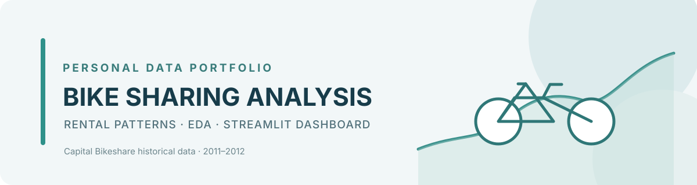
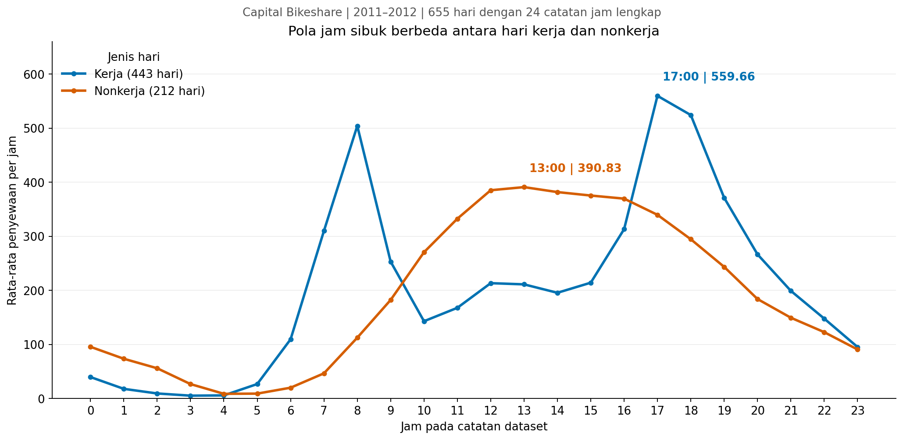
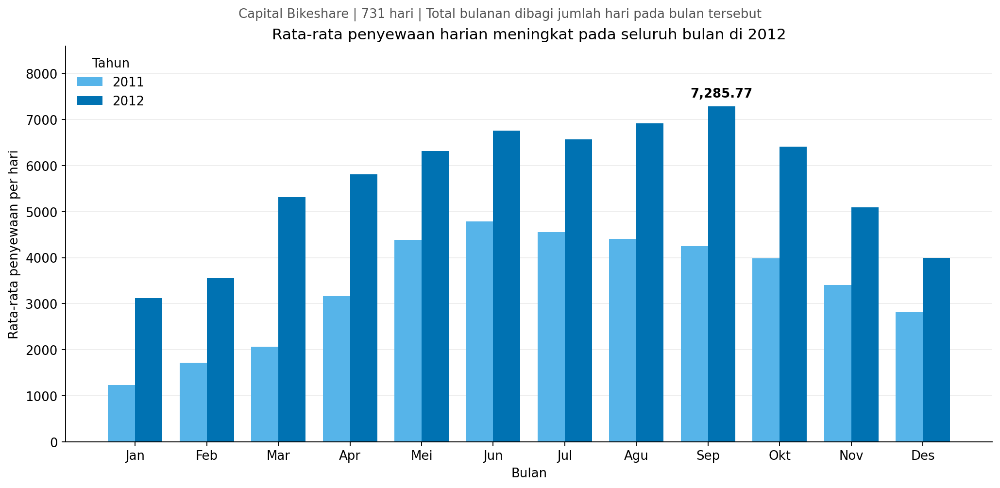
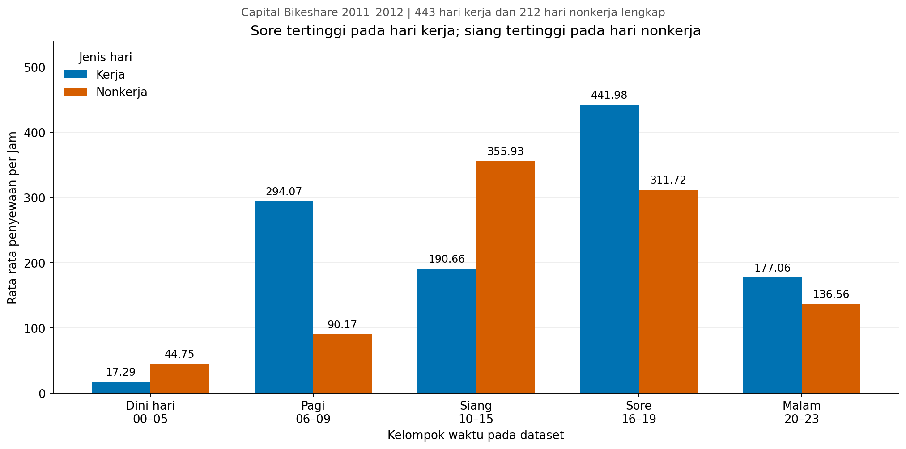
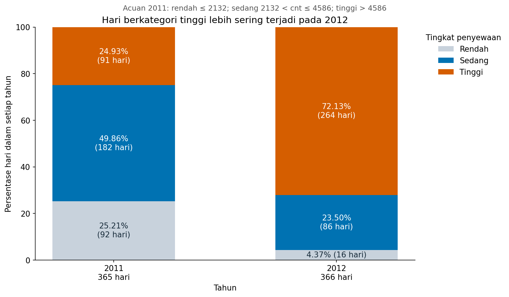

# 🚲 Bike Sharing Analysis

**Exploring Capital Bikeshare rental patterns with Python, EDA, and Streamlit.**

  
  

---

## 📌 About This Project

Kapan sepeda paling banyak disewa dalam sehari? Apakah pola penyewaan saat working days berbeda dengan non-working days?

Project ini merupakan bagian dari personal data analytics portfolio-ku. Menggunakan **Capital Bikeshare Dataset periode 2011–2012**, aku mengeksplorasi pola penyewaan sepeda, membandingkan rental activity berdasarkan jenis hari, dan melihat perubahan demand dari bulan ke bulan.

Prosesnya mencakup data preparation, exploratory data analysis (EDA), data visualization, hingga pengembangan interactive dashboard menggunakan Streamlit. Fokusnya bukan sekadar menghasilkan grafik, tetapi memahami pola di balik data dan menyampaikan insight dengan konteks yang tepat.

## 🎯 Project Objectives

Ada dua pertanyaan utama yang menjadi fokus analisis:

1. **Peak Rental Hours** — Pada jam berapa rata-rata penyewaan sepeda mencapai nilai tertinggi saat working days dan non-working days?
2. **Monthly Rental Trends** — Bagaimana perubahan rata-rata penyewaan harian pada setiap bulan tahun 2012 dibandingkan dengan bulan yang sama pada 2011?

## 🗂️ Dataset Overview

Dataset yang digunakan adalah **Bike Sharing Dataset** dari sistem Capital Bikeshare, dengan periode pengamatan Januari 2011 hingga Desember 2012.

| Dataset | Description | Records |
|---|---|---:|
| `day.csv` | Daily rental records | 731 |
| `hour.csv` | Hourly rental records | 17,379 |
| `Readme.txt` | Original dataset documentation | — |

**Dataset highlights**

- Total recorded rentals: **3,292,679**
- Average daily rentals: **4,504.35**
- Observation period: **January 2011 – December 2012**
- Complete hourly records: **655 days**

**Data quality note:** Dari 17,544 hourly calendar slots yang seharusnya tersedia, terdapat 165 slot yang tidak tercatat pada 76 tanggal. Missing records tidak langsung dianggap sebagai zero rentals. Untuk menjaga konsistensi perbandingan pola per jam, analisis utama menggunakan 655 hari dengan 24 observasi lengkap.

## ⚙️ Analysis Workflow

| Stage | What I Did |
|---|---|
| Data Gathering | Membaca daily dan hourly datasets |
| Data Assessing | Memeriksa data types, missing records, duplicates, dan konsistensi data |
| Data Cleaning | Menyiapkan kolom tanggal, meninjau nilai yang perlu diperiksa, dan membuat analytical features |
| EDA | Mengeksplorasi hourly rental patterns dan monthly trends |
| Data Visualization | Menyajikan hasil melalui grafik dan perbandingan |
| Advanced Analysis | Menggunakan manual grouping, binning, dan sensitivity checks |
| Dashboard Development | Mengembangkan interactive dashboard dengan Streamlit |

## 📊 Key Findings

### 01. Peak Rental Hours

Terdapat perbedaan pola waktu puncak penyewaan antara working days dan non-working days.

**Working Days**

| Rank | Hour | Average Rentals |
|---|---:|---:|
| 🥇 | 17:00 | 559.66 |
| 🥈 | 18:00 | 524.11 |
| 🥉 | 08:00 | 504.05 |

**Non-working Days**

| Rank | Hour | Average Rentals |
|---|---:|---:|
| 🥇 | 13:00 | 390.83 |
| 🥈 | 12:00 | 385.07 |
| 🥉 | 14:00 | 381.65 |

**What I found:** Pada working days, rental activity lebih tinggi pada pagi dan sore hari, terutama sekitar waktu berangkat dan pulang kerja. Sementara itu, non-working days menunjukkan aktivitas penyewaan yang lebih tinggi pada siang hari.

### 02. Monthly Rental Trends

Rata-rata penyewaan harian pada 2012 meningkat di setiap bulan jika dibandingkan dengan bulan yang sama pada 2011.

Beberapa highlights:

- **March:** mencatat year-over-year growth terbesar, yaitu **157.44%**, atau bertambah sekitar **3,252.58 rentals per day**.
- **September:** memiliki rata-rata penyewaan harian tertinggi pada 2012, yaitu **7,285.77 rentals per day**.

Interesting takeaway: bulan dengan pertumbuhan tertinggi tidak selalu menjadi bulan dengan rental volume tertinggi.

### 03. Advanced Analysis

Untuk memperdalam hasil EDA, aku juga melakukan grouping dan binning agar pola penyewaan bisa dilihat dari sudut pandang yang berbeda.

- Mengelompokkan catatan per jam ke dalam lima time blocks.
- Mengategorikan daily rental levels menggunakan quartile tahun 2011.
- Membandingkan proporsi high-demand days pada 2011 dan 2012.
- Melakukan sensitivity checks menggunakan alternatif quantile thresholds.

Pada analisis time blocks, periode **16:00–19:00** memiliki rata-rata tertinggi pada working days, yaitu **441.98 rentals per hour**. Untuk non-working days, periode **10:00–15:00** memiliki rata-rata tertinggi, yaitu **355.93 rentals per hour**.

Dengan threshold referensi yang sama dari 2011, proporsi high-demand days meningkat dari **24.93% pada 2011 menjadi 72.13% pada 2012**. Kategori ini merupakan pengelompokan relatif terhadap data 2011, bukan standar kapasitas operasional.

## 📈 Data Visualization

Visualisasi berikut merupakan hasil analisis yang tersimpan di repository.

**Hourly Rental Patterns**

**Monthly Rental Comparison**

**Time Block Analysis**

**Daily Rental Demand Levels**

## 🌐 Interactive Dashboard

Sebagai pelengkap analisis, aku mengembangkan dashboard interaktif menggunakan **Streamlit**. Dashboard ini menyajikan hasil analisis dalam tampilan yang lebih visual dan memungkinkan eksplorasi berdasarkan filter yang tersedia.

**Dashboard highlights:**

- 📅 Date range selection.
- 🗓️ Working days dan non-working days comparison.
- ⏰ Hourly rental analysis.
- 📊 Monthly rental trends.
- 🔎 Advanced demand analysis.
- 📥 Downloadable analytical tables in CSV format.

  <a href="https://tatavvaka-bike-sharing.streamlit.app/"><strong>🌐 Explore the Live Dashboard</strong></a>

## 🛠️ Tools & Technologies

| Technology | Role |
|---|---|
| Python | Main programming language |
| Pandas | Data manipulation and cleaning |
| NumPy | Numerical computation |
| Matplotlib | Data visualization |
| Streamlit | Interactive dashboard |
| Jupyter Notebook | Exploratory data analysis |
| Git & GitHub | Version control and project documentation |

## 📁 Project Contents

| File / Folder | Description |
|---|---|
| `notebook.ipynb` | Main exploratory data analysis |
| `dashboard/` | Streamlit dashboard and analysis modules |
| `data/` | Original and processed datasets |
| `outputs/figures/` | Analysis visualizations |
| `outputs/tables/` | Analytical summary tables |
| `outputs/advanced/` | Advanced analysis results |
| `outputs/quality/` | Data quality assessment |
| `docs/` | Project documentation and findings |
| `tests/` | Dashboard tests |
| `requirements.txt` | Project dependencies |

## 🔎 Limitations

Beberapa hal yang perlu diperhatikan saat membaca hasil analisis:

- Dataset hanya mencakup periode 2011–2012, sehingga tidak merepresentasikan kondisi bike-sharing saat ini.
- Analisis bersifat descriptive dan tidak membuktikan hubungan sebab-akibat.
- Rental counts tidak sama dengan jumlah unique customers.
- Dataset tidak menyediakan informasi lengkap mengenai actual fleet availability maupun unmet demand.
- Penyebab missing hourly records belum dapat dipastikan.

## 📚 References

1. Fanaee-T, H. (2013). *Bike Sharing Dataset*. UCI Machine Learning Repository. [https://doi.org/10.24432/C5W894](https://doi.org/10.24432/C5W894)
2. Dicoding Indonesia — *Belajar Analisis Data dengan Python*.
3. [Pandas Documentation](https://pandas.pydata.org/docs/)
4. [Streamlit Documentation](https://docs.streamlit.io/)

---

  Made with curiosity and a little love for data. 🤍

